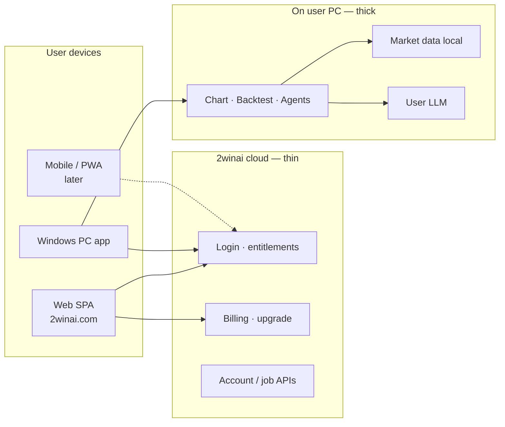
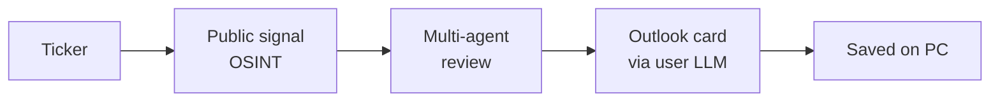
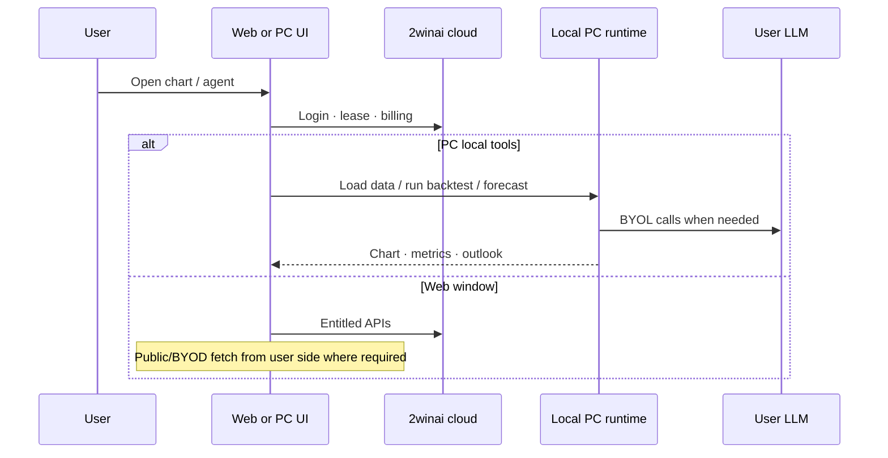

# 2winai-terminal — Product capability brief

**Audience:** partners, technology companies, due-diligence reviewers  
**Purpose:** what the product does, what problem it solves, how capability is organized — **not** implementation secrets  
**Product:** [2winai.com](https://2winai.com) · Windows PC app · web SPA  
**Vendor:** Amarantine AI CO., LTD (2WinAI)  
**Disclaimer:** tools for market study and technical workflow — **not** investment advice

---

## 1. One-line pitch

**Local-first market terminal:** interactive chart + strategy backtest + AI assistants that run with **the user’s own data and the user’s own LLM** — while 2winai supplies the workspace, orchestration, and cloud account services.

| Problem for users | How 2winai-terminal responds |
|-------------------|------------------------------|
| Chart tools without owning the data warehouse | **BYOD** — folder / API keys / public feeds on the **user’s machine or browser** |
| AI chat that ships keys and answers to a vendor cloud | **BYOL** — user connects their LLM; keys stay client/PC-side |
| “Black box” forecast on someone else’s server | **Price Forecast Agent** on **PC** — collect public signal → multi-agent review → user LLM concludes |
| One stack for web + desktop | Same product family: **web** for account/chart window; **PC app** for full local tools |

---

## 2. Product surfaces

| Surface | Role |
|---------|------|
| **Web** | Sign-in, pricing, chart workspace, chat (as entitled), upgrade |
| **PC app** | Full local data folder, native data pickers, Price Forecast Agent, local history |
| **Cloud** | Identity, plans, payments — **not** a shared OHLCV data pool |

---

## 3. Capabilities (what users get)

Sections below. No separate “project map” diagram — the tables and flows are enough for partners.

### 3.1 Chart & market workspace

- Interactive chart workspace (browser-class SPA).
- Symbol discovery across equities / FX / crypto / commodities (as sources allow).
- Recent chart/cache history on the client or PC — not a vendor-owned market database.

**Solves:** “I need a professional chart window on my data,” without redistributing licensed feeds from 2winai servers.

### 3.2 Data connections (BYOD + public)

| Mode | Idea |
|------|------|
| **Folder** | User points the PC app at their own market files |
| **API (user keys)** | User pastes provider credentials locally; requests use **their** quota |
| **Public** | Free public connectors fetched from **user IP** (PC or browser), with clear ToS |

**Solves:** legal/ops risk of “vendor scrapes and caches the world for everyone.” Data stays under the user’s roof.

### 3.3 Backtest

- Run strategy checks on series the user has already resolved.
- Results stored as **local run artifacts** on PC (dev/cloud job paths for advanced API where entitled).

**Solves:** AmiBroker-style “test my rule on my bars” inside the same terminal as the chart.

### 3.4 Chat Agent (BYOL)

- Conversational assistant wired to the user’s chosen LLM endpoint.
- Can use **Active Data** context (what the user selected as current market source).
- Chat history kept on the PC / client store — not as a shared cloud knowledge base of answers.

**Solves:** AI help without forcing a single vendor LLM or shipping provider API keys to 2winai disk.

### 3.5 Price Forecast Agent (Premium · PC)

**User-visible idea only** (not a build recipe):

- Runs on the **Windows PC app** (Premium). Web shows the feature entry and directs users to the PC app.
- 2winai **orchestrates** tools and a structured review; the **user’s LLM** writes the readable outlook. Results stay on the PC.
- **Solves:** research assist for a ticker without 2winai hosting a shared “price prediction” service.
- **Not:** auto-trade, guaranteed accuracy, investment advice, or a disclosed agent-framework bill of materials.

### 3.6 Account, plans, admin

- Google sign-in · plan gates (Free / Basic / Premium).
- Upgrade / payment on cloud.
- Admin tools for operations (user view, entitlement support).

---

## 4. How parts work together (system view)

**Design principle:** thick capability on the **user side**; thin **identity & commerce** on the cloud.

---

## 5. Technology profile (for technical evaluation)

Enough for a peer engineering team to judge maturity — **not** a bill of materials for cloning.

| Layer | Choices (public product posture) |
|-------|----------------------------------|
| Backend API | **Python** · **FastAPI** |
| Frontend | **TypeScript** · **React** · **Vite** · chart via **ECharts** |
| Desktop | Windows installer · thin local shell + local runtime |
| Auth / billing | Google identity · JWT session model · PayPal upgrade path |
| Application DB | **PostgreSQL** (account / entitlements / billing metadata — not a shared market OHLCV warehouse) |
| Data posture | Local disk / browser storage for BYOD & BYOL; cloud gated against shared market pools |
| i18n | EN / VN UI |

### 5.1 Cloud, CI/CD, and database ops

| Area | What partners can assume |
|------|--------------------------|
| **Source & CI/CD** | **GitHub** + **GitHub Actions** — build, test, and deploy pipelines for the web/API image and related release artifacts |
| **Google Cloud (GCP)** | Experience shipping on **GCP** (e.g. containerized API/SPA, Secret Manager patterns, Google sign-in integration) |
| **AWS** | Parallel / migration path experience (e.g. **Lightsail** or equivalent VM + container pull) for production hosting |
| **Managed SQL** | **Cloud SQL for PostgreSQL** (GCP) — and/or equivalent managed Postgres — for identity and commerce data |
| **Secrets** | Cloud secret stores + env injection in deploy; **no** product docs that list live credentials |

### 5.2 AI stack (what we name — and what we do not)

| Named | Not named in this brief |
|-------|-------------------------|
| BYOL (user LLM) · OSINT · multi-agent **orchestration** (product concept) | Specific frameworks such as **LangChain / LangGraph**, proprietary swarm kits, prompt packs, model routing tables |

Partners evaluate **capability and ops maturity**, not a cloneable agent recipe.

### Maturity signal (honest)

| Dimension | Level (partner reading) |
|-----------|-------------------------|
| Shipping | **Production** web + **released** Windows app lineage (chart → data plugins → forecast) |
| Architecture | **Mid-stage product**: clear web vs PC surfaces, entitlement gates, local-first privacy rules |
| AI | **Orchestration + BYOL** (not a closed proprietary LLM-as-product) |
| DevOps | **GitHub Actions CI/CD** · **GCP** and **AWS** hosting familiarity · **Postgres / Cloud SQL** for account data |
| Platform roadmap | Mobile/PWA and partner API / MCP-style integration **planned / stubbed** where noted in product plans |
| Compliance posture | Explicit **not advice** · BYOD/BYOL ToS · no shared OHLCV redistributor claim |

**Skill signals a hiring/partner team can infer:** full-stack Python+TS, SPA+API packaging, desktop packaging, entitlement/security UX, multi-agent **product** design, cloud CI/CD (GitHub → GCP/AWS), managed PostgreSQL ops.

---

## 6. What we deliberately do **not** expose here

- Internal module names, prompt text, model routing tables, or agent framework forks (including whether/how LangChain, LangGraph, or similar are used)  
- Decode details of proprietary file formats beyond “local folder of market files”  
- Secrets, key formats, connection strings, or infra credentials  
- Exact OSINT sources, filter heuristics, agent counts, or numeric policy rules inside Forecast  
- Abuse-detection internals beyond “session / entitlement protections exist”  
- Project mindmaps / internal module trees (not needed for partner evaluation)

Partners who need deeper diligence: schedule a **controlled technical review** under NDA — not this brief.

---

## 7. Quick FAQ

**Is this a data vendor?**  
No. Users bring data (folder / their API / public connectors under their ToS).

**Where does AI run?**  
User-chosen LLM (local and/or their cloud keys). Forecast orchestration is PC-side for the full agent.

**Can another tech company integrate?**  
Product direction includes B2B-style API and later tool/MCP-style hooks; scope and keys are commercial — ask sales/engineering under agreement.

**Investment advice?**  
No. Outlook cards and chat are decision-support tools only.

---

## 8. Document control

| Field | Value |
|-------|-------|
| File | `docs/2WINAI_TERMINAL_PRODUCT_BRIEF.md` |
| Language | English (partner / tech evaluation) |
| Status | Partner-safe overview |
| Related public notes | `docs/deploy/CHANGELOG_0.6.0.md` · legal About pages |

*End of brief.*
